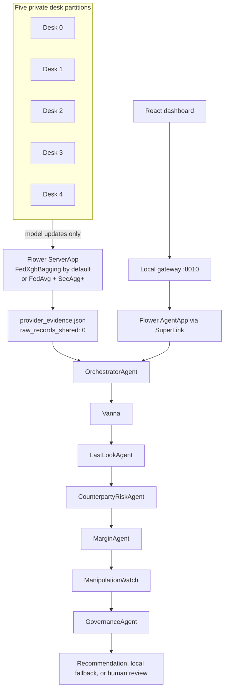

# Vanna: federated FX execution intelligence

In FX, the tightest quote on screen is not always the cheapest trade to finish: a liquidity provider can reject the order at the last moment, and a desk cannot pool the raw orders that would show who actually fills.

*Built at the Flower Cambridge Federated AI hackathon, top 5. See [HACKATHON.md](HACKATHON.md).*

## What it does

Vanna is a prototype for that problem. Five desks train a shared model on private execution histories, and only model updates leave a desk. A fixed chain of typed agents reads the shared evidence and produces an advisory recommendation. Governance checks sit in front of the answer, and a person has the final say.

Desk data in this repository is **synthetic**. It is generated from per-desk profiles, so the system can be run from end to end without real trading records.

## How it works



1. **Federate.** Each desk trains locally, and Flower merges the updates into one model per round. The default strategy is `FedXgbBagging`. With `secure-aggregation=true`, the run switches to FedAvg over a NumPy logistic model under Flower's `SecAggPlusWorkflow`.
2. **Export evidence.** The final model produces per-provider estimates of fill probability, rejection, slippage and latency. That approved summary is what gets shared. The export sets `raw_records_shared` to 0, and the provenance block names the source of each field.
3. **Reason.** `OrchestratorAgent` runs six roles in order: Vanna, LastLook, CounterpartyRisk, Margin, ManipulationWatch, Governance. Each one adds its own `explain()` line.
4. **Decide.** Governance can allow a local recommendation, ask for a smaller size, use a local fallback, ask for human review, or suppress collective output. The dashboard's approval queue writes a local `PENDING_HUMAN_APPROVAL` audit record and does not place a broker order.

## Technical highlights

- **Federated XGBoost by default** (`apps/federation/vanna_federation/server_app.py`). `CheckpointingFedXgbBagging` wraps Flower's `FedXgbBagging`, saves each round's model, and writes a training manifest (`persistence.py`, `apps/federation/artifacts/training_manifest.json`).
- **Optional secure aggregation** (`secagg.py`). XGBoost trees cannot be added together, so this mode trains the logistic model instead. The run config sets `num-shares` to 5 and `reconstruction-threshold` to 3. The FedAvg strategy still asks for five clients (`min_available_clients=5`). Both modes export the same evidence schema. A conditional client mod applies `secaggplus_mod` only to SecAgg+ traffic, so both modes share one ClientApp.
- **Privacy checks in code.** `packages/vanna-core/src/vanna_core/privacy.py` builds desk-local pseudonyms with HMAC-SHA256 and buckets notional and latency. `validate_shared_payload` rejects fields such as `client_id`, `uti`, `exact_notional` and `live_intention`. The federation app keeps its own copy of those checks, and also rejects `hash_id`, `secret` and `vault`. The AgentApp scans the evidence file again before any agent reads it.
- **The cost comes from code** (`packages/vanna-core/src/vanna_core/decisioning.py`). Expected executable cost = slippage + 2.5 × rejection probability + latency/100 + 2 × (1 − fill probability) − displayed price benefit. Confidence is high, medium or low from the sample count and the age of the evidence. The language model only narrates the result.
- **Typed hand-offs** in `apps/agent/vanna_agent/agents/` (`orchestrator.py`, `vanna.py`, `last_look.py`, `counterparty_risk.py`, `margin.py`, `manipulation_watch.py`, `governance.py`). Pydantic contracts in `contracts.py` set `extra="forbid"`. `automatic_execution`, `automatic_blacklist`, `collective_instruction` and `misconduct_finding` are typed as `Literal[False]`. Last-look asymmetry is raised as a review signal, and the chain does not turn it into an automatic blacklist.
- **One desk compared with five** (`apps/agent/vanna_agent/xgboost_local.py`). This trains a model on desk 0's saved partition and compares it, per provider, with the federated ensemble. Both are scored on desk 0's held-out split.
- **A path with no live services** (`scripts/local_demo.py`). It runs the deterministic pipeline on the last approved evidence file. It does not wait for a Flower server or a model endpoint.

## Finding your way around

A Flower app bundle cannot combine an `AgentApp` with a `ServerApp`/`ClientApp` pair, so the repository has two Flower apps.

```text
apps/federation/       five-desk Flower federation (XGBoost or SecAgg+) and evidence export
apps/agent/            AgentApp, six agent roles, local gateway, connectors
apps/dashboard/        React dashboard for running the chain and reviewing evidence
packages/vanna-core/   shared privacy, schemas, decisioning and governance
scripts/               evidence hand-off and the deterministic local run
tests/                 privacy, federation, SecAgg+, decisioning, agents, gateway
```

`DEMO.md` is the demo script.

## Testing

`tests/` contains 46 Python tests, covering privacy, both federation modes, federated XGBoost, decisioning, the gateway and every agent.

```bash
uv sync && uv run pytest
```

That command is the quick start from a fresh clone. XGBoost is a root dependency because the federation tests and the desk comparison import it.

The dashboard has Vitest tests in `apps/dashboard/src/App.test.tsx`, `api.test.ts` and `data/source.test.ts`.

The evidence file's own `provenance` block describes the synthetic inputs. Slippage, latency and rejection come from XGBoost regressions on synthetic desk-profile targets. Displayed price benefit, rejection asymmetry and sample count are fixed synthetic values.

Figures such as the desk-0-only LP_C estimate of about 60% are illustrative examples from the 26 August 2026 run on synthetic data, not benchmarks. They are collected in [HACKATHON.md](HACKATHON.md).

This prototype does not execute trades, blacklist providers, send collective instructions, or replace a compliance system.

## Stack

Python 3.11 or newer, Flower 1.35.0 (simulation, SuperLink, SuperGrid and AgentApp), XGBoost, NumPy, Pydantic and uv. The dashboard uses React, TypeScript, Vite and Vitest. An Alpha Vantage key is optional, and is used only for a public FX quote.

Narration calls an OpenAI Responses-compatible endpoint. The hackathon runs used a hosted Qwen model; the gateway passes `/models/Qwen3.5-397B-A17B-FP8` unless `VANNA_TERMINAL_MODEL_ID` is set. If the AgentApp itself has no model id, it uses `glm-5.2-fp8`. The narration loop exposes six tools, allows at most three turns (`MAX_TOOL_TURNS`), and times out after 120 seconds. If the call fails, the run prints a deterministic write-up of the same pipeline result.

## Running it

```bash
git clone https://github.com/molyleelatham/vanna-federated-fx-execution.git
cd vanna-federated-fx-execution
uv sync && uv run pytest
uv run python scripts/local_demo.py
```

The local demo needs the installed packages. It does not need a running SuperLink or a model endpoint.

**Five-desk federation**

```bash
cd apps/federation && uv sync
uv run flwr run . --federation-config="num-supernodes=5" --stream
# secure mode: add --run-config "secure-aggregation=true"
cd ../.. && uv run python scripts/sync_federation_artifact.py
```

The sync script copies `provider_evidence.json` and the final ensemble into the AgentApp, and converts desk 0's `.npz` partition to JSON for the comparison.

**Dashboard**

```bash
# Terminal 1
export FLWR_MODEL_API_ENDPOINT="<full /v1/responses endpoint>"
uv run flower-superlink --insecure

# Terminal 2. The Alpha Vantage key is optional and belongs in this environment.
export ALPHAVANTAGE_API_KEY="<key>"
cd apps/agent && uv run python -m vanna_agent.gateway   # 127.0.0.1:8010

# Terminal 3
cd apps/dashboard && npm install && npm run dev         # Vite's default port, 5173
```

The gateway checks SuperLink at `127.0.0.1:9093`. `Assess order` queues a Flower AgentApp run and the page polls for that run's result. `Send to approval queue` writes the local audit record described above. Without an Alpha Vantage key, or if that call fails, the quote strip shows its local fallback.

**AgentApp on Flower SuperGrid**

```bash
cd apps/agent
uv run flwr build
uv run flwr login supergrid
uv run flwr run . supergrid --stream
```

The SuperNode scripts use the deployment federation `@molyleela/Vanna`. Each desk is started with `supernode_setup.sh` and `start_supernode_desk_{0..4}.sh`. Melanie ran those SuperNodes.
